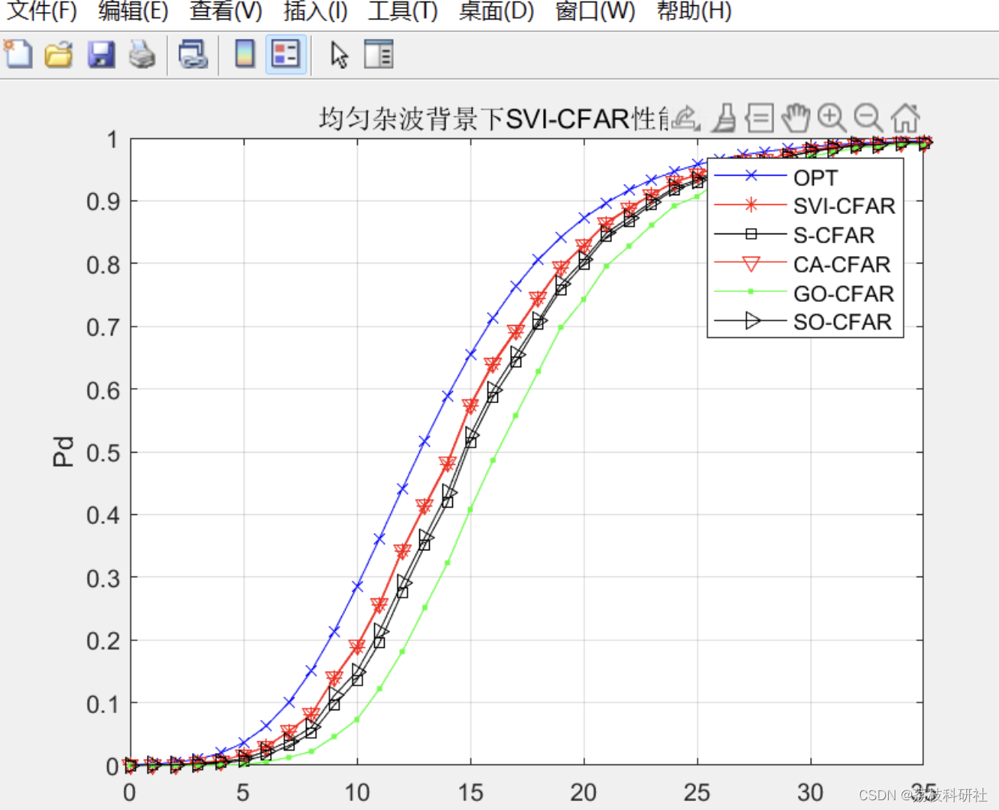
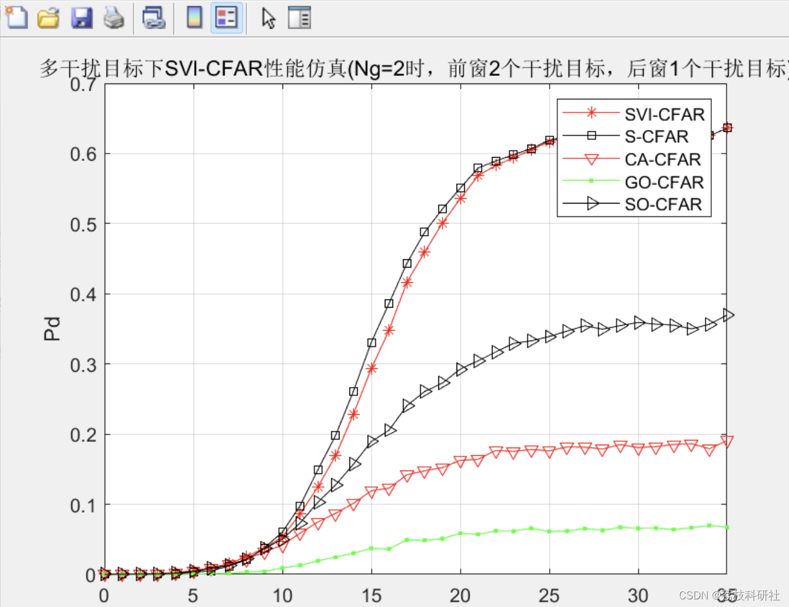
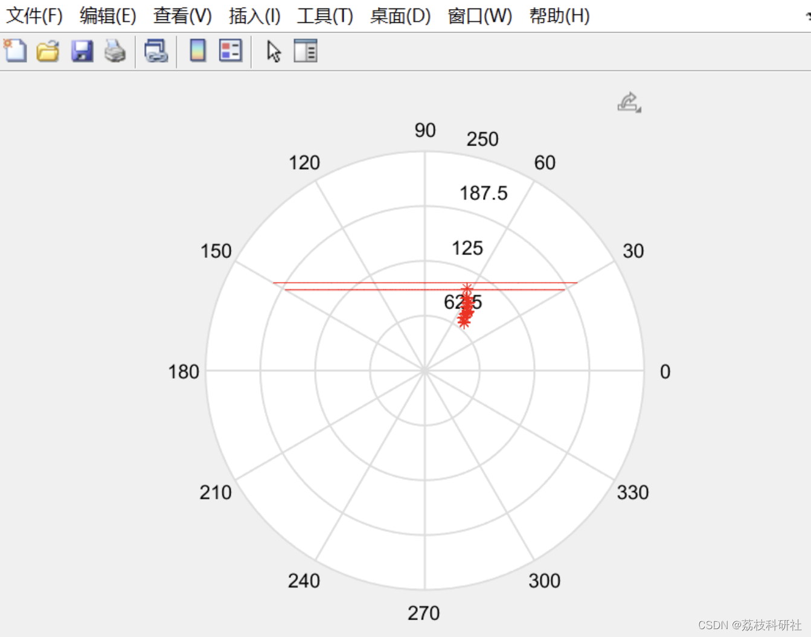
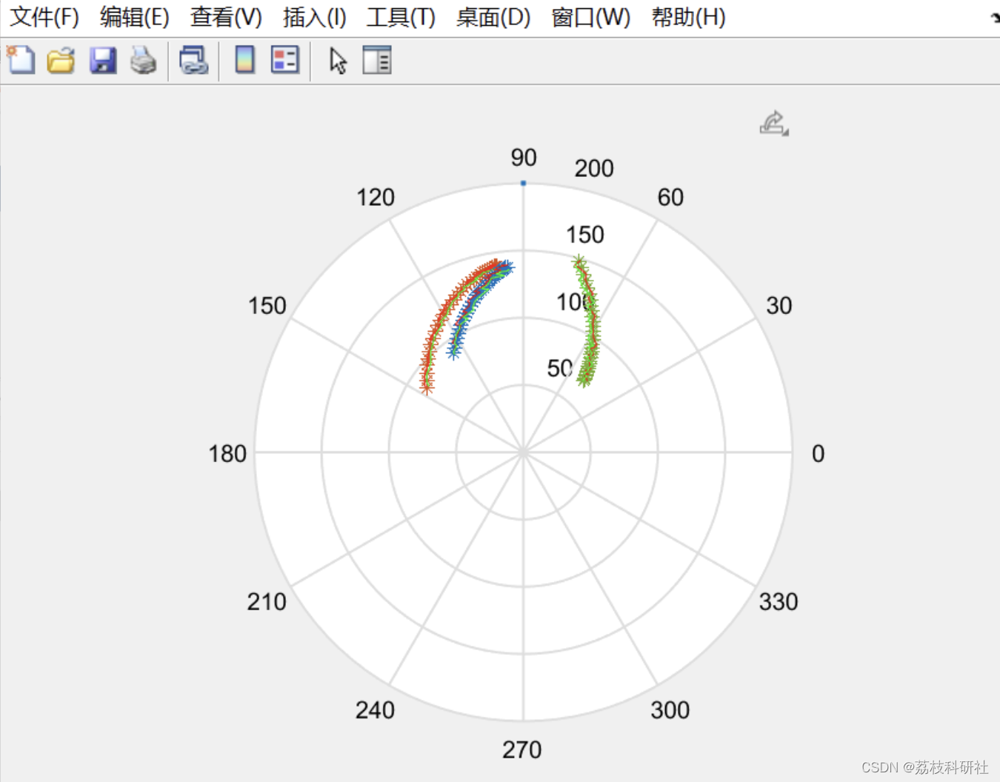
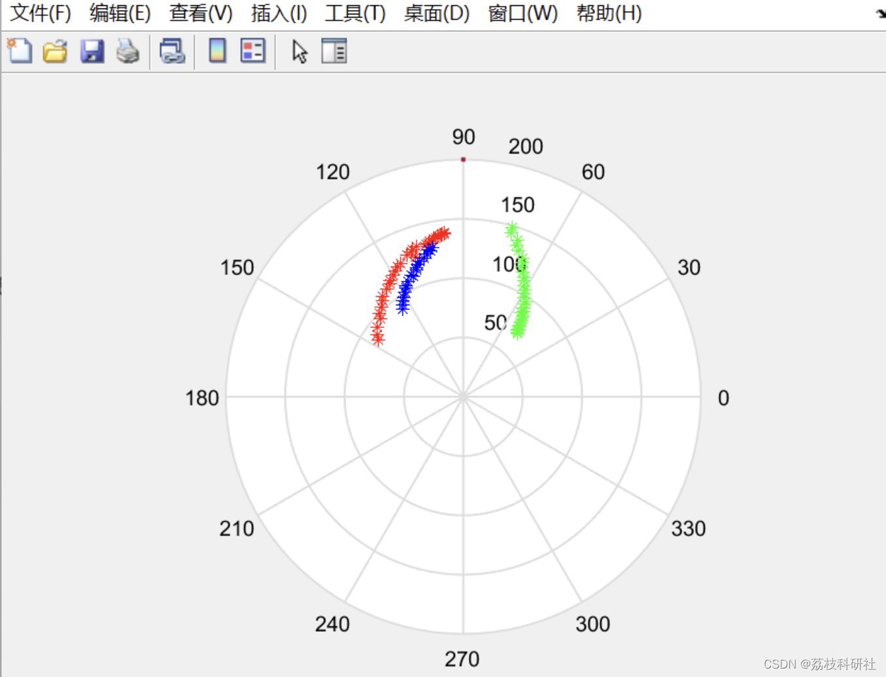
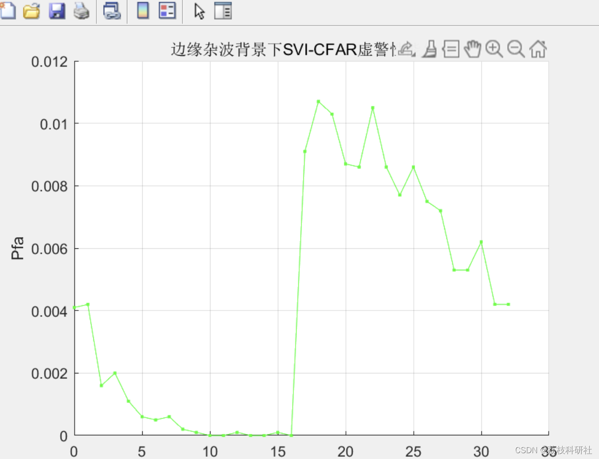
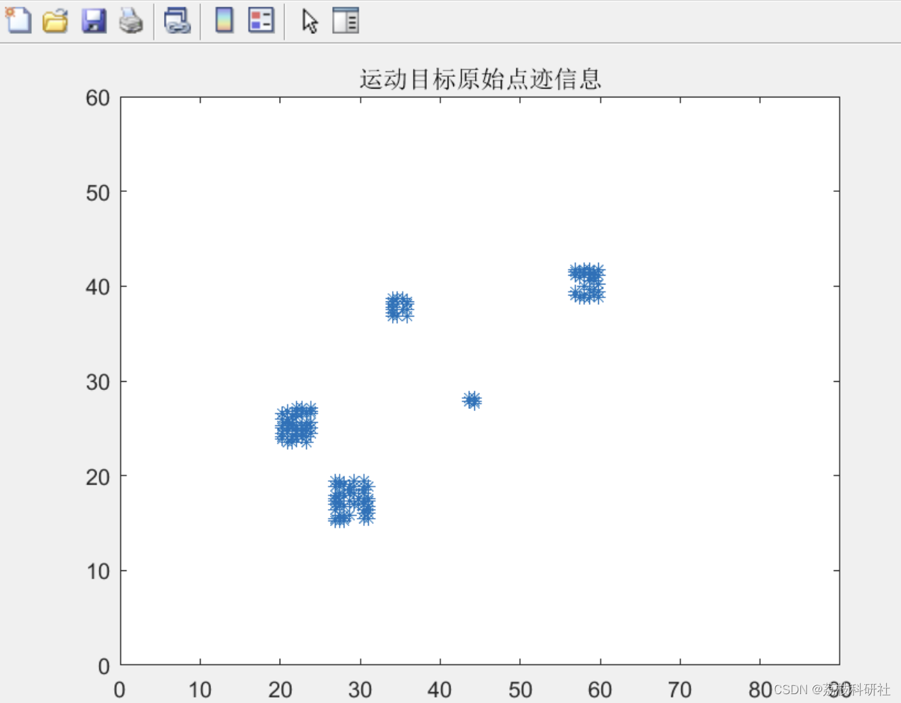
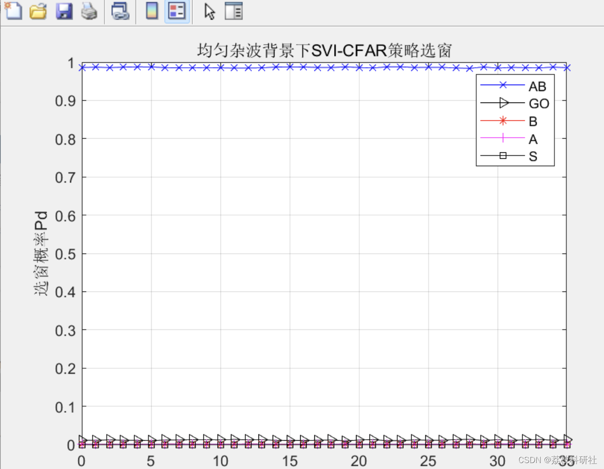
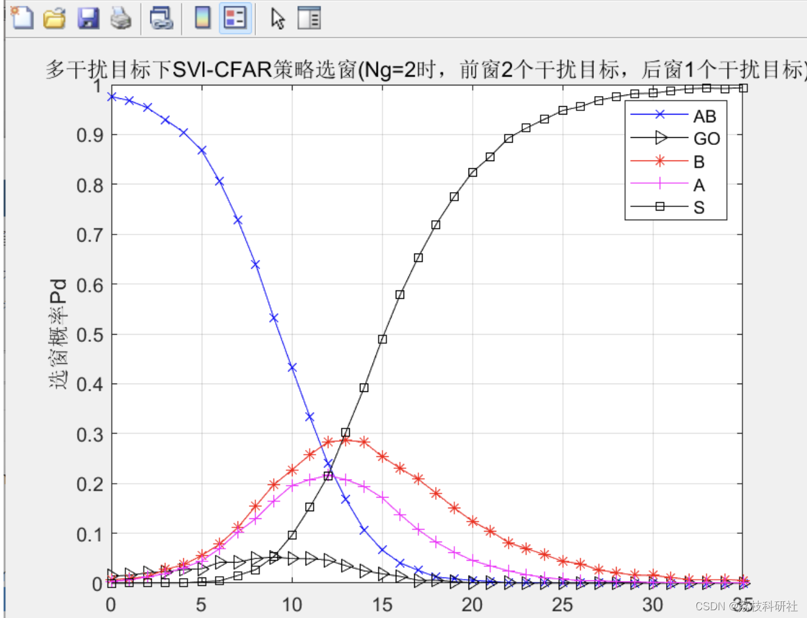

# Radar Communication: Simulation of Radar Probe Project (Matlab Code Implementation)

​  
📚2 Running Results Editing
Editor
Editor
Editor
Editor
Editor
Editor
Part of the code:
clear all  
N=24; % reference unit length
M=1e7; % Monte Carlo simulation count
pfa=1e-3;  
alpha=0.4;  
beta1=10.87;  
beta2=10.87;  
Nt=12;  
KVI=4.56;  
KMR=2.9;  
SNR_dB=10;  
SNR=10.^(SNR_dB./10);  
pd_svi=0;  
pd_vi=0;  
pd_s=0;  
pd_so=0;  
pd_go=0;  
pd_ca=0;  
for Nc=0:N  
count_svi=0;  
count_vi=0;  
count_go=0;  
count_ca=0;  
count_so=0;  
count_s=0;  
for j=1:M  
if(Nc<=N/2)  
lambda=SNR;  
u1=rand(1,Nc);%%xiu gai  
u2=rand(1,N-Nc);  
exp_noise(1:Nc)=log(u1)*(-lambda);  
exp_noise(Nc+1:N)=log(u2)*(-1);  
u=rand(1,2);  
exp_target=log(u(1))*(-1);  
else  
lambda=SNR;  
u1=rand(1,Nc);  
u2=rand(1,N-Nc);  
exp_noise(1:Nc)=log(u1)*(-lambda);  
exp_noise(Nc+1:N)=log(u2)*(-1);  
u=rand(1,2);  
exp_target=log(u(1))*(-lambda);  
end  
clear all  
N=24; % reference unit length
M=1e7; % Monte Carlo simulation count
pfa=1e-3;  
alpha=0.4;  
beta1=10.87;  
beta2=10.87;  
Nt=12;  
KVI=4.56;  
KMR=2.9;  
SNR_dB=10;  
SNR=10.^(SNR_dB./10);  
pd_svi=0;  
pd_vi=0;  
pd_s=0;  
pd_so=0;  
pd_go=0;  
pd_ca=0;  
for Nc=0:N  
count_svi=0;  
count_vi=0;  
count_go=0;  
count_ca=0;  
count_so=0;  
count_s=0;  
for j=1:M  
if(Nc<=N/2)  
lambda=SNR;  
u1=rand(1,Nc);%%xiu gai  
u2=rand(1,N-Nc);  
exp_noise(1:Nc)=log(u1)*(-lambda);  
exp_noise(Nc+1:N)=log(u2)*(-1);  
u=rand(1,2);  
exp_target=log(u(1))*(-1);  
else  
lambda=SNR;  
u1=rand(1,Nc);  
u2=rand(1,N-Nc);  
exp_noise(1:Nc)=log(u1)*(-lambda);  
exp_noise(Nc+1:N)=log(u2)*(-1);  
u=rand(1,2);  
exp_target=log(u(1))*(-lambda);  
end  
🎉3 References
🌈4 Matlab code implementation

## Images

<!-- PAYMENT_BLOCK -->

## Get this dataset

- Payment link (Stripe): [Buy now](https://buy.stripe.com/3cs8yP7sY87d0vu9AB)
- Payment QR code: 

<!-- /PAYMENT_BLOCK -->
